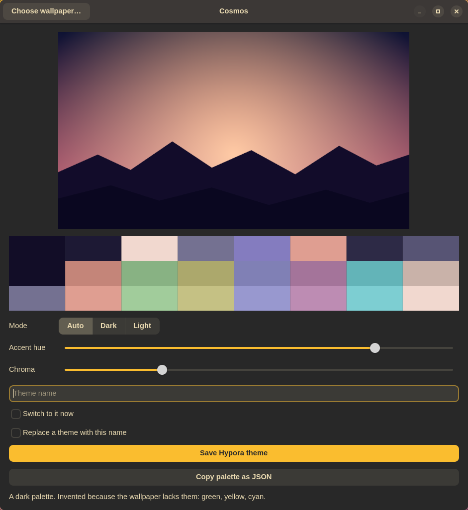

<p align="center">
  
</p>

<h1 align="center">Cosmos</h1>

<p align="center">Turn a wallpaper into a colour theme for your desktop.</p>

<p align="center">
  
</p>

## What it does

You pick a picture. Cosmos works out its main colours and builds a full set from them: a background, text colour, an accent, and the 16 colours a terminal uses. Then it either saves a theme for [Hypora](#using-hypora) or fills in your own config files with those colours.

- Text is always easy to read. Cosmos checks the contrast and adjusts colours that are too faint.
- If the picture is missing a colour (a sunset has no green, for example), Cosmos makes one up and tells you which ones.
- The same picture always gives the same colours.

## Install

These steps are for Fedora.

```
sudo dnf install cargo gcc gtk4-devel
git clone https://github.com/Misfitxtm/Cosmos.git
cd Cosmos
./install.sh
```

The installer builds Cosmos and puts it in `~/.local`. It does not use sudo, and it does not touch anything outside your home folder.

- No window, just the command line? Run `./install.sh --cli-only`. You can skip `gtk4-devel`.
- To remove Cosmos: `./install.sh --uninstall`. Your settings and saved themes are left alone.
- If your terminal can't find `cosmos`, add `~/.local/bin` to your `PATH`.

## Use the window

Open **Cosmos** from your app menu, or run `cosmos-gtk`.

1. Click **Choose wallpaper…**.
2. Look at the colours. Use **Dark** or **Light** if you don't like what Auto picked.
3. Move **Accent hue** and **Chroma** to change the accent colour.
4. Type a name and click **Save Hypora theme**. Tick **Switch to it now** to use it straight away.

You can try it with the picture in this folder: `docs/demo-wallpaper.png`.

## Use the command line

```
cosmos wallpaper.jpg                        # just look at the colours; saves nothing
cosmos wallpaper.jpg --name Sunset          # save a Hypora theme called Sunset
cosmos wallpaper.jpg --name Sunset --apply  # save it and switch to it
cosmos wallpaper.jpg --json                 # print the colours for scripts
cosmos wallpaper.jpg --templates            # fill in your own templates (see below)
```

| Option | What it does |
|---|---|
| `--mode dark` or `light` | Choose the style. The default follows the picture. |
| `--dry-run` | Show what would be written, and write nothing. |
| `--force` | Replace a theme that already exists. The old one is kept as `colors.toml.bak`. |
| `--base NAME` | Copy the font and icon theme from another Hypora theme. |

If switching to the new theme fails, Cosmos switches back to the one you had before.

## Using Hypora

Cosmos saves themes in `~/.config/hypora/themes/` and switches with `hypora-theme`. Hypora can update the login and boot screens too, but that needs sudo, so Cosmos never asks. It prints the exact command for you to run if you want it.

## Not using Hypora?

Cosmos can fill in any text file. Make a template with colour names in curly brackets, then list it in `~/.config/cosmos/config.toml`:

```toml
# ~/.config/cosmos/config.toml
[[template]]
src  = "kitty.conf"                          # in ~/.config/cosmos/templates/
dest = "~/.config/kitty/current-theme.conf"  # must be inside your home folder
post = ["pkill", "-USR1", "-x", "kitty"]     # optional: run this afterwards
```

```
# ~/.config/cosmos/templates/kitty.conf
background {background}
foreground {foreground}
color1     {red}
selection_background {selection.rgb}
```

Then run `cosmos wallpaper.jpg --templates`.

Colour names: `background`, `surface`, `foreground`, `dim`, `accent`, `error`, `selection`, `muted`, `black`, `red`, `green`, `yellow`, `blue`, `magenta`, `cyan`, `white`, the `bright_` versions of those eight, and `color0` to `color15`. Add a style after the name:

| Write | You get |
|---|---|
| `{accent}` | `#7ba4f0` |
| `{accent.strip}` | `7ba4f0` |
| `{accent.rgb}` | `123,164,240` |
| `{accent.rgbs}` | `123 164 240` |
| `{accent.rgba}` or `{accent.rgba:0.5}` | `rgba(123, 164, 240, 0.5)` |
| `{mode}` | `dark` or `light` |

If a name is spelled wrong, Cosmos stops and writes nothing.

## Is it safe?

Cosmos opens pictures from the internet and writes files into your config folders, so it is careful:

- Pictures are size-checked before they are opened, so a tiny file can't unpack into gigabytes.
- It only writes inside your home folder, never follows a link to somewhere else, and never leaves a half-written file.
- Theme names and colours are checked, so nothing sneaky can end up in a config file.
- It never runs anything through a shell, and never asks for your password.

One thing to know: **the `post` command in a config file runs on your computer.** Treat a config someone else gave you like a script and read it first. Cosmos shows each command before it runs it, and `--dry-run` shows them without running anything.

The full security review is in [AUDIT.md](AUDIT.md).

## Good to know

- Cosmos is for Linux. It is developed on Fedora with Hyprland.
- Hypora is the only desktop with built-in support. Everything else works through templates.
- Pictures can be PNG, JPEG or WebP.

## Build it yourself

```
cargo build --release
cargo test
```

The window lives in its own part (`cosmos-ui`) that needs `gtk4-devel`. Build it with `cargo build --release -p cosmos-ui`. An RPM spec for Fedora is in `packaging/`. Run `packaging/make-sources.sh` to make the source files, then `rpmbuild -ba packaging/cosmos.spec` (or `mock`) to build it.

## Licence

The code, the documentation and the images in `docs/` are GPL-3.0-or-later. See [LICENSE](LICENSE).

**The Cosmos icon is the one exception.** It is proprietary: copyright 2026 Misfitxtm, and not under the GPL. You may fork and use it, but only in association with Cosmos (a fork or a package of Cosmos can include it). Any other use needs permission. See [LICENSE-ICON](crates/cosmos-cli/assets/LICENSE-ICON).
